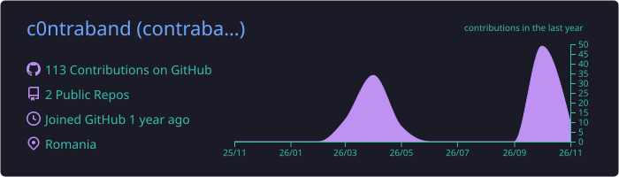
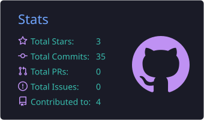
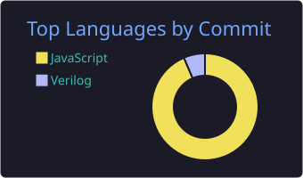

<div align="center">


<br/>


</div>

---

### `> whoami`

```yaml
name: contraband
builds: conversational AI, chat automation, the dashboards that run it
backend: Python · Go
frontend: React · TypeScript
infra: Docker · PostgreSQL · Redis · Linux · Caddy
ai: LLM pipelines, prompt engineering, safety reads, cost tuning
status: junkie, addicted to automation
motto: if it can be automated, it will be
```

### `> stack`

<p align="center">
  
</p>

### `> stats`

<p align="center">
  
</p>
<p align="center">
  
  
</p>

<p align="center">
  
</p>

### `> contributions`

<p align="center">
  <picture>
    <source media="(prefers-color-scheme: dark)" srcset="https://raw.githubusercontent.com/c0ntraband/c0ntraband/output/snake-dark.svg" />
    
  </picture>
</p>

<div align="center">

```
 most of the good stuff lives in private repos ¯\_(ツ)_/¯
```

</div>
